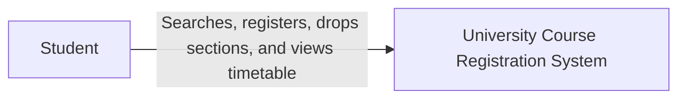
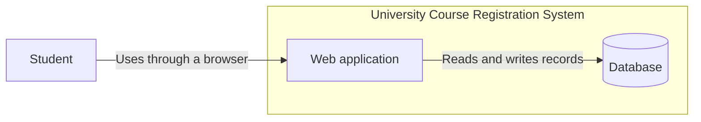
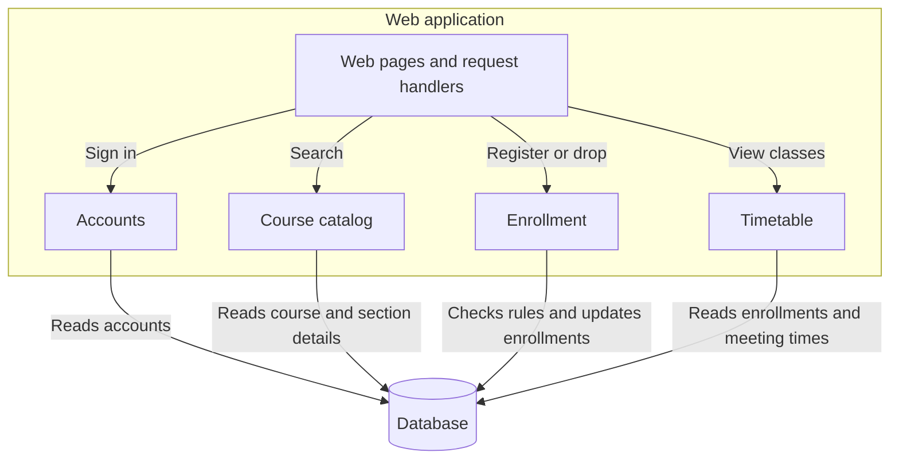

# Group 04 — System Architecture

Our system is a website where students can search for courses, register for
sections, drop sections, and view their semester timetable. The demo covers
one semester and uses fictional student and course records.

## C4 Level 1 — System Context

This diagram shows who uses the system and what they use it for.

## C4 Level 2 — Containers

Students open the web application in a browser. The application handles their
requests and uses a database to store accounts, course sections, meeting
times, prerequisites, enrollments, and registration and drop periods.

## Component Diagram — Inside the Web Application

The web pages pass each request to the part of the application that handles it.

| Component | What it does | Requirements |
| --- | --- | --- |
| Accounts | Lets students sign in with demo accounts. | FR-01 |
| Course catalog | Finds courses by name or code and shows their sections, meeting times, and available seats. | FR-02 |
| Enrollment | Checks registration and drop periods and updates the signed-in student's enrollments when the applicable rules pass. | FR-03–07, NFR-01, NFR-02 |
| Timetable | Shows the signed-in student's enrolled classes by day and time. | FR-08, NFR-01 |

For example, when Leen clicks **Register**, the Enrollment component checks
whether registration is open, whether she has passed the prerequisites,
whether a seat is available, and whether the section overlaps with another
class. If the checks pass, the system saves the enrollment and the section
appears on her timetable.

## First Design Checkpoint

The first increment, `v0.1.0-design`, focuses on demo sign-in and course
search. The diagrams also show where registration, dropping sections, and
the timetable will fit in later increments.
