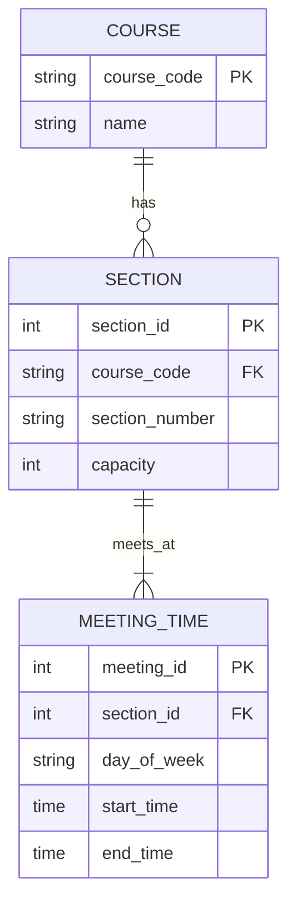

# Group 04 — Course and Section Data Model

A course, such as Data Structures, can have several sections. Each
section has its own capacity and meeting times. Students search by
course name or code, then compare the sections.

For the first demo, the catalog can show available seats using sample
enrollment counts. Once registration is implemented, available seats
will be the section's capacity minus its active enrollments.
