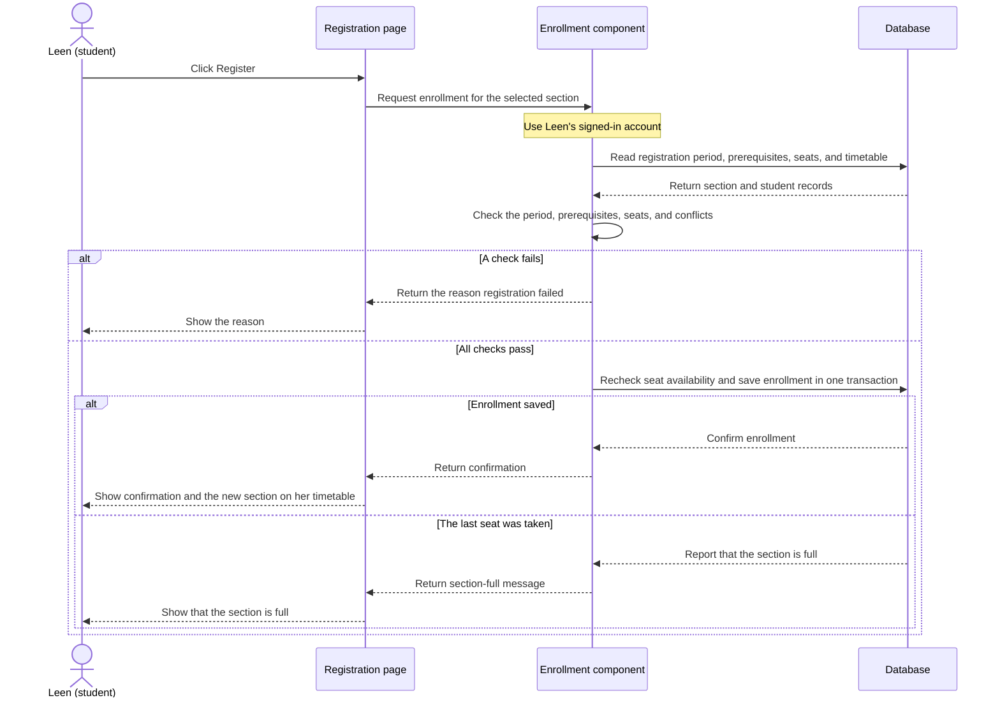

# Group 04 — Registration Sequence Diagram

Leen is signed in and has selected a course section. This diagram shows
what happens after she clicks **Register**.

If registration fails, nothing is added to Leen's timetable. The final seat
check and enrollment save happen together so two students can't both claim
the last seat.
