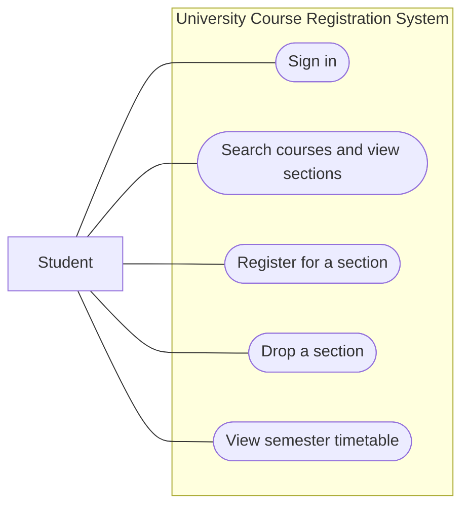

# Group 04 — Use Case Diagram

The student is the main user of the University Course Registration System.
The diagram shows the actions students can take during the demo semester.

Registration and dropping are available during their respective periods.
When a student registers, the system also checks prerequisites, available
seats, and timetable conflicts.
